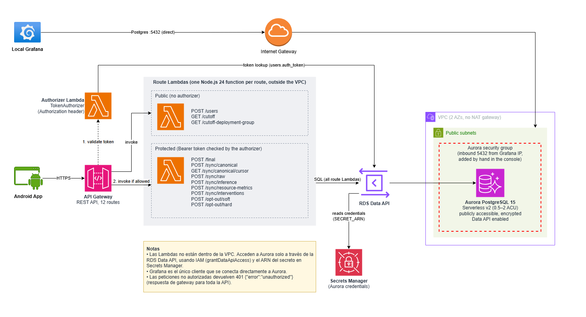
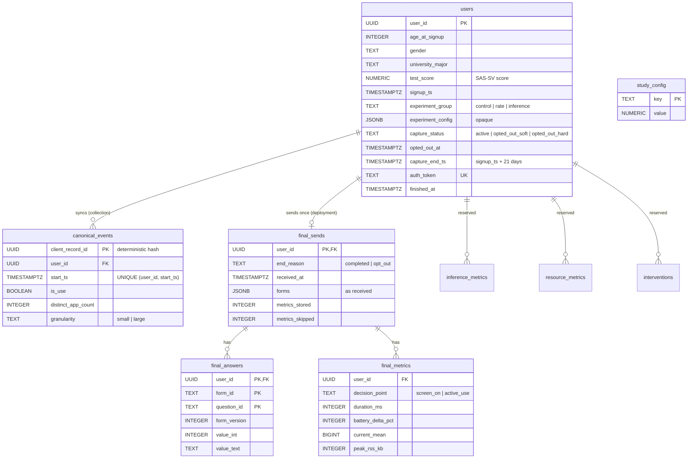

# SmartUse Backend

Backend for the *Trabajo Profesional de Graduación* **SmartUse**:

> *Prototipo de sistema de detección y reducción de uso compulsivo de
> smartphones en estudiantes universitarios guatemaltecos mediante un modelo
> predictivo y un módulo de intervención UI/UX.*

This repository holds the backend and data-management code used to capture
Android usage behaviour from 30+ Guatemalan university students. The capture
is built around the use/non-use representation proposed by Lin et al.
[[1]](#references) for identifying compulsive smartphone use. It is published
as evidence for the thesis and so the infrastructure can be reproduced. It
contains no study data and no credentials.

## Contents

- [Study context](#study-context)
- [Repository layout](#repository-layout)
- [Architecture](#architecture)
- [Data model](#data-model)
- [API](#api)
- [Requirements](#requirements)
- [Reproducing the deployment](#reproducing-the-deployment)
- [Admin monitoring (Grafana)](#admin-monitoring-grafana)
- [Data export and acceptance scripts](#data-export-and-acceptance-scripts)
- [References](#references)

## Study context

Participants belong to one of three experiment groups:

| Group | Name | What the app does |
|---|---|---|
| `control` | Control | Captures usage only; no interventions. Control population for analysis. |
| `rate` | Random intervention | Triggers the UI/UX intervention at random, to measure the effect of the intervention itself. |
| `inference` | Directed intervention | Triggers the intervention from an ML model that predicts upcoming compulsive-use events. |

The `rate` group's trigger probability comes from the empirical probability
that a control-group participant shows compulsive use within the ML model's
prediction horizon. The random group stays random but runs at a realistic
rate, so the effects of directed and undirected interventions can be
compared.

The study ran in two phases, which use different parts of this backend:

1. **Data collection** (`control` group app). The app syncs use/non-use
   epochs (`/sync/canonical`) and raw `UsageStatsManager` dumps
   (`/sync/raw`) for 21 days per participant. That data trains the
   prediction model.
2. **Deployment** (`inference` group app). The app runs the model on the
   device. For ethical reasons **no usage data, model scores, predictions or
   intervention data ever reach the backend**: only registration data, the
   end-of-study questionnaires and anonymised performance metrics, sent once
   through `POST /final`.

The backend stores this data securely and durably, lets participants opt out,
and gives the researcher enough visibility to track the study against its
participant and data-volume goals.

## Repository layout

```
src/                     AWS CDK app (TypeScript) — infrastructure + Lambda code
  bin/app.ts             CDK entry point: Network, Data and Api stacks
  lib/                   Stack definitions (+ CDK assertion tests)
  lambda/<route>/        One Lambda per API route (+ unit tests)
  lambda/common/         Shared RDS Data API helpers
  lambda/schema-migration/  Custom resource that applies db/schema.sql on deploy
  db/schema.sql          Full, idempotent Postgres schema
docs/api/openapi.yaml    OpenAPI 3 contract of the public endpoints
docs/aws/                Infrastructure diagram (PNG + draw.io source)
grafana/                 Local admin Grafana: provisioning, dashboard, setup scripts
scripts/                 Data export and post-deploy acceptance checks (Python)
```

## Architecture



*(Editable source: `docs/aws/aws_infrastructure.xml`, opens in diagrams.net.)*

The infrastructure is fully serverless and is defined in three CDK stacks:

- **`SmartUseNetworkStack`**: a VPC with 2 AZs, public subnets only and no
  NAT gateway, plus the Aurora security group.
- **`SmartUseDataStack`**: Aurora Serverless v2 (PostgreSQL 15, 0.5–2 ACU,
  storage encrypted, Data API enabled), an S3 bucket for raw usage dumps
  (SSE-S3, public access blocked, TLS enforced), and a custom resource that
  applies `src/db/schema.sql` on each deploy.
- **`SmartUseApiStack`**: an API Gateway REST API with 12 routes, one Node.js
  24 Lambda per route, and a Lambda `TOKEN` authorizer.

Design decisions:

- **The Lambdas run outside the VPC.** They reach Aurora through the **RDS
  Data API** (IAM plus the cluster secret in Secrets Manager), not through a
  Postgres connection. They don't need VPC networking, NAT gateways or
  connection pooling, which keeps costs low.
- **Aurora is the only resource inside the VPC.** It is publicly addressable,
  but its security group declares no inbound rules in code. The only client
  that connects directly is the researcher's local Grafana, whose IP is added
  by hand in the console. Because CloudFormation never declares ingress on
  that group, deploys never overwrite those rules.
- **The schema is code.** `schema.sql` is written so every statement can be
  re-run. The migration custom resource is keyed by a hash of the file, so
  any edit replays the whole file on the next deploy.

## Data model



- **`canonical_events`** holds the use/non-use epochs. It is insert-only and
  has no `end_ts`. Epochs form a contiguous timeline per participant, so an
  epoch's duration is derived on the server as
  `LEAD(start_ts) OVER (PARTITION BY user_id ORDER BY start_ts) - start_ts`.
- **`final_sends` / `final_answers` / `final_metrics`** hold the deployment
  group's single end-of-study send. `final_metrics` deliberately has no time
  or ordering column, because the app shuffles the records and sends no
  timestamps.
- **`study_config`** holds key/value research parameters
  (`participant_goal`, `volume_goal_hours`, `intervention_rate`).
- **Raw `UsageStatsManager` dumps** are not stored in a table. They go to S3
  as one object per sync batch, at `raw/<user_id>/<batch_id>.json`. They
  serve only as an audit trail.
- **Admin views:** `v_participant_hours`, `v_active_participants` and
  `v_volume_vs_goal`.
- **Reserved tables:** `inference_metrics`, `resource_metrics` and
  `interventions` exist in the schema for the original three-stream design,
  but their sync endpoints answer `501`. After the ethics constraint above,
  the deployment app never sends that data.

## API

The full request and response contracts are in
[`docs/api/openapi.yaml`](docs/api/openapi.yaml). You can open it in any
OpenAPI viewer, such as `npx @redocly/cli preview-docs docs/api/openapi.yaml`.

| Method | Route | Auth | Used by | Purpose |
|---|---|---|---|---|
| POST | `/users` | — | both apps | Register; returns `user_id` and `auth_token` |
| GET | `/cutoff` | — | collection | Global cutoff date of the collection study |
| GET | `/cutoff-deployment-group` | — | deployment | Cutoff date of the deployment study (or `null`) |
| POST | `/sync/canonical` | Bearer | collection | Batch of use/non-use epochs (≤ 500); returns `synced_through` |
| GET | `/sync/canonical/cursor` | Bearer | collection | Recover the canonical sync watermark |
| POST | `/sync/raw` | Bearer | collection | Raw usage dump, stored verbatim in S3 |
| POST | `/opt-out/soft` | Bearer | collection | Stop capture, keep data |
| POST | `/opt-out/hard` | Bearer | collection | Stop capture and delete the participant's data |
| POST | `/final` | Bearer | deployment | End-of-study questionnaires + performance metrics, once |
| POST | `/sync/inference` | Bearer | — | Reserved, `501` |
| POST | `/sync/resource-metrics` | Bearer | — | Reserved, `501` |
| POST | `/sync/interventions` | Bearer | — | Reserved, `501` |

All error bodies have the shape `{"error": "<code>", "message": "..."}`. A
missing or unknown token is rejected at the gateway with
`401 {"error": "unauthorized"}`. A `5xx` means nothing was stored and the
request is safe to retry unchanged.

## Requirements

These are the backend requirements. Code comments cite them by ID.

### Registration (`REQ-REG`)

- **REQ-REG-01**: `POST /users` creates the participant. The backend
  generates `user_id` and `auth_token`. The app supplies the signup data (age,
  gender, major, test score) and `experiment_group`.
- **REQ-REG-02**: The researcher chooses the group for each install and the
  app declares it. The backend never assigns or randomizes groups.
- **REQ-REG-03**: `capture_end_ts = signup_ts + 21 days` is computed once, at
  registration.
- **REQ-REG-04**: `experiment_config` (JSONB) is stored as-is and never
  interpreted.

### Authentication and encryption (`REQ-AUTH`, `REQ-ENC`)

- **REQ-AUTH-01..04**: A bearer token is issued once, by `POST /users`, and
  sent as `Authorization: Bearer <token>` on every authenticated route. The
  Lambda authorizer resolves it to a `user_id`. Tokens do not expire. Their
  purpose is to keep out non-participant traffic, not to withstand a targeted
  attacker.
- **REQ-ENC-01..04**: TLS on every request, which is API Gateway's only
  listener. Aurora storage is encrypted with an AWS-managed KMS key, and S3
  with SSE-S3. No customer-managed keys are used.

### Sync protocol (`REQ-SYNC`)

- **REQ-SYNC-01..03**: The expected load is tens of participants, so
  requests go straight from API Gateway to Lambda to RDS or S3, with no queue.
  The contract would stay the same if a queue were added later.
- **REQ-SYNC-04..08**: Sync is push-only and triggered by the client
  (periodically or when connectivity returns). The canonical and raw streams
  are independent: each has its own cursor, and a failure in one never blocks
  the other.
- **REQ-SYNC-09..11**: Every record has a client-generated
  `client_record_id`, which is resent unchanged on retries. Each batch is
  inserted in a single statement,
  `INSERT … ON CONFLICT (client_record_id) DO NOTHING`, so a `2xx` means the
  whole batch committed and a retry is harmless.
- **REQ-SYNC-12**: Raw batches are keyed by a client-generated batch UUID,
  so a retried batch overwrites its S3 object instead of duplicating it.
- **REQ-SYNC-13/14**: An epoch is synced only after it closes, and stored
  rows are immutable.
- **REQ-SYNC-14a**: Canonical records carry no `end_ts`. Duration is derived
  on the server from the next epoch's `start_ts`.
- **REQ-SYNC-14b**: `is_use` is required, because it cannot be derived from
  `distinct_app_count` (a use epoch can have zero recorded apps).
- **REQ-SYNC-14c**: The app never syncs a participant's most recently closed
  epoch. On the server, the newest epoch has no successor, so its duration is
  `NULL` and drops out of `SUM()`. As a result `v_participant_hours` lags the
  true total by at most one epoch, by design.
- **REQ-SYNC-15..17**: There is no partial success. On a `2xx` the client
  deletes exactly the records it sent. On anything else it keeps the whole
  batch and retries.
- **REQ-SYNC-18/19**: Sync endpoints do **not** check `capture_status`, so
  opt-out is enforced by the app. They **do** reject requests after
  `capture_end_ts`, because the capture window is a hard data-volume
  constraint of the study.
- **REQ-SYNC-20**: A canonical `client_record_id` is a deterministic hash of
  the epoch's identifying fields. If the app reconstructs the same epoch
  twice, the duplicate turns into an `ON CONFLICT DO NOTHING` no-op.
- **REQ-SYNC-21/22**: `UNIQUE (user_id, start_ts)` backs this up in case of
  epoch-construction bugs that the hash cannot catch. A batch that would
  violate it is rejected in full with `409 epoch_conflict`.
- **REQ-SYNC-23**: `epoch_conflict` signals a data-integrity problem, not a
  transient failure. The app must not retry it automatically.
- **REQ-SYNC-24..26**: A successful `POST /sync/canonical` returns
  `synced_through`, which is computed from stored state (`MAX(start_ts)`) and
  not echoed from the request. `GET /sync/canonical/cursor` returns the same
  value so the app can recover a lost sync boundary.
- The Data API rejects SQL strings over 64 KB, which caps a canonical batch
  at 500 records. Larger batches get `413` and are never truncated.

### Opt-out and capture window (`REQ-OPT`, `REQ-CAP`)

- **REQ-OPT-01**: `POST /opt-out/soft` sets
  `capture_status = opted_out_soft` and keeps the data already captured.
- **REQ-OPT-02**: `POST /opt-out/hard` deletes the participant's
  `canonical_events`, `inference_metrics` and raw S3 objects, then sets
  `opted_out_hard`. The `users` row is kept so participant counts stay
  accurate. Every step is idempotent.
- **REQ-OPT-03**: Opt-out is not enforced on the sync endpoints
  (REQ-SYNC-18).
- **REQ-CAP-01/02**: Each participant has their own capture window,
  `signup_ts` to `capture_end_ts`. The app stops syncing when the window ends,
  and the backend rejects late syncs as a backstop.

### Research parameters and reserved streams (`REQ-RATE`, `REQ-RES`, `REQ-INT`)

- **REQ-RATE-03**: `intervention_rate` is a research parameter stored in
  `study_config`, not in code.
- **REQ-RES-01**, **REQ-INT-01**: The endpoints for idle RAM/battery
  readings (all groups) and intervention outcomes (`rate`/`inference`) are
  reserved. The tables exist and the routes answer `501` (see
  [Data model](#data-model)).

### Admin monitoring (`REQ-ADM`)

- **REQ-ADM-01**: There are no admin HTTP endpoints. The views
  `v_participant_hours`, `v_active_participants` and `v_volume_vs_goal`
  provide the progress figures.
- **REQ-ADM-02**: The goals (`volume_goal_hours`, `participant_goal`) are
  config values in `study_config`, not hardcoded.
- **REQ-ADM-03**: A local Grafana connects to Aurora directly as a read-only
  role and queries those views (see
  [Admin monitoring](#admin-monitoring-grafana)).

### Deployment group (`REQ-DEP`)

The deployment app registers every participant as
`experiment_group = "inference"` and calls only `POST /users`,
`GET /cutoff-deployment-group` and `POST /final`.

- **REQ-DEP-01..05** (registration): For `inference` only, `test_score` (the
  SAS-SV screening score) must be an integer from 10 to 60, otherwise the
  request gets `400`. Other groups keep their original rule. The score is
  stored in the existing `users.test_score` column.
- **REQ-DEP-06..08** (cutoff): `GET /cutoff-deployment-group` needs no auth
  and always returns `200 {"cutoff": "YYYY-MM-DD" | null}`. The value is
  hardcoded in `src/lambda/cutoff-deployment-group/index.ts`, independently
  of `GET /cutoff`, and changes only by redeploying. The app decides what it
  means: the study ends at 00:00 America/Guatemala on that date, or at signup
  + 21 days, whichever comes first.
- **REQ-DEP-09** (order of checks in `POST /final`): (1) the authorizer
  checks the token (`401`); (2) if a send for this user already exists, the
  handler returns `200 {"status": "already_received"}` and changes nothing,
  so the first send wins; (3) it validates the body (`400`); (4) it stores
  the send (`201 {"status": "stored"}`).
- **REQ-DEP-10/11** (validation): A request gets `400 invalid_body` only when
  the body is unusable:
  - it is not a JSON object;
  - `end_reason` is not `completed` or `opt_out`;
  - `forms` or `forms.usability` is missing;
  - a form's `version` is not an integer ≥ 1;
  - an answer is not an integer or a string, or is an integer outside the
    int32 range.

  Question ids and answer values are not validated, because they change with
  the questionnaire version. NUL characters and lone surrogates in text
  answers are replaced with U+FFFD rather than rejected.
- **REQ-DEP-12** (metrics): A bad metric record never causes a `400`. It is
  skipped, counted in `final_sends.metrics_skipped`, and logged without its
  values.
- **REQ-DEP-13/14** (storage): The handler stores everything in one SQL
  statement built from data-modifying CTEs, so the send is all-or-nothing.
  `final_sends.user_id` is the primary key, so when two concurrent sends race
  the second one ends in `200 already_received`, never `409` or `5xx`. The
  same statement sets `users.finished_at`.
- **REQ-DEP-15/16** (size): Answers and metrics are passed as JSON
  parameters and expanded with `jsonb_to_recordset`, so the SQL text stays
  the same size at any record count. The handler accepts at least 10,000
  metric records and a body of at least 2 MB within API Gateway's 29 s limit
  (the Lambda has a 28 s timeout and 512 MB of memory).
- **REQ-DEP-17**: `/final` does not check `capture_end_ts`, `capture_status`
  or `experiment_group`, because the send arrives on or after day 21 by
  design.
- **REQ-DEP-18**: The API-wide `UNAUTHORIZED` gateway response returns
  `{"error": "unauthorized"}`.
- **REQ-DEP-19..21**: The storage tables are `final_sends`, `final_answers`
  and `final_metrics`, as shown in the data model. `final_metrics` has no
  surrogate key, and no S3 copy of the raw body is kept.
- **REQ-DEP-22/23**: A deployment participant stays silent on the backend
  for 21 days or more. No rule may treat that silence as dropping out. Their
  state changes only through `POST /final`, where an in-app opt-out arrives
  as `end_reason = "opt_out"`.

Test users register with `university_major = "QA-BACKEND-CHECK"`. Analysis
and dashboards filter them out.

## Reproducing the deployment

### Prerequisites

- An AWS account and the AWS CLI v2, configured with a profile. The scripts
  default to a profile named `smartuse` and to `us-east-1`; override them with
  `AWS_PROFILE` / `AWS_REGION`.
- Node.js 24 and [pnpm](https://pnpm.io/) (the lockfile is `pnpm-lock.yaml`).
- Python 3.10+ with `boto3`, for the scripts.
- Optional: Windows PowerShell, for the local Grafana launcher, and `bash`
  plus `openssl`, for its setup script.

### Build, test, deploy

```bash
cd src
pnpm install
pnpm build          # tsc --noEmit
pnpm test           # jest: unit tests for every handler + CDK assertion tests

export AWS_PROFILE=smartuse
npx cdk bootstrap   # once per account/region
npx cdk deploy --all
```

`cdk deploy` creates the three stacks and runs the schema migration. It
prints the API's base URL as an output of `SmartUseApiStack`
(`https://<api-id>.execute-api.<region>.amazonaws.com/prod/`). Deploying
again after editing `src/db/schema.sql` replays the schema, which is safe
because every statement can be re-run.

Running costs at study scale are dominated by Aurora Serverless v2's 0.5 ACU
minimum. Remove everything with `npx cdk destroy --all`. Under CDK's default
removal policies, the raw-dumps S3 bucket is retained and Aurora leaves a
final snapshot. Delete both by hand if you don't want to keep them.

### Verify

```bash
python scripts/check_deployment.py https://<api-id>.execute-api.<region>.amazonaws.com/prod
```

This runs the deployment-group acceptance checks (below) against the live
stack. Every user it creates is tagged `QA-BACKEND-CHECK`.

### Configuration

- **Study cutoffs:** edit the constants in `src/lambda/cutoff/index.ts` and
  `src/lambda/cutoff-deployment-group/index.ts`, then redeploy.
- **Research parameters:** update `study_config` directly
  (`participant_goal`, `volume_goal_hours`, `intervention_rate`).
  `grafana/setup-db-access.sh` sets the first two.

## Admin monitoring (Grafana)

Everything in `grafana/` is provisioned as code: a Postgres datasource and
the *SmartUse — Sync Status* dashboard, which shows users syncing,
continuous hours and days of data, split by study.

1. **Allow your IP.** In the AWS console, go to EC2 → Security Groups →
   `SmartUseNetworkStack-AuroraSecurityGroup…` → Edit inbound rules and add
   PostgreSQL (5432) from `<your-ip>/32`. You can get your IP with
   `curl https://checkip.amazonaws.com`. CDK never touches this rule. Home
   IPs change, so repeat this step if Grafana stops connecting.
2. **Create the read-only role.** Run `bash grafana/setup-db-access.sh` once;
   it is safe to re-run. Through the Data API it creates the `grafana_ro`
   role, sets the study goals, and writes the gitignored `grafana/.env` with a
   generated password. To override the goals, run
   `PARTICIPANT_GOAL=15 VOLUME_GOAL_DAYS=150 bash grafana/setup-db-access.sh`.
3. **Run Grafana.** Run
   `powershell -ExecutionPolicy Bypass -File grafana/run-grafana.ps1`. On the
   first run it downloads portable Grafana OSS into `grafana/.bin`, with no
   Docker or installer. It serves <http://localhost:3000> on loopback only,
   without a login.

`grafana_ro` can read every table except `users.auth_token`, and it has a
30 s statement timeout. It cannot read `v_active_participants`, which is a
`SELECT *` over `users` and would expose the tokens. The role defaults to
read-only transactions.

## Data export and acceptance scripts

| Script | What it does |
|---|---|
| `scripts/check_deployment.py <api_base_url>` | Acceptance checks for `POST /users` (inference rules), `GET /cutoff-deployment-group` and `POST /final`. It covers every `400` case, idempotent resends, concurrent resends, skipped metrics, a 10,000-record send and the `401` body. |
| `scripts/export_canonical.py <out.csv>` | Exports `canonical_events` to CSV through the Data API, using keyset pagination. |
| `scripts/export_study_data.py <out_dir>` | Exports `users.csv` (without `auth_token`), `final_answers.csv` and `final_metrics.csv`. |

The export scripts locate the cluster and its secret through the AWS API, so
they work from any network without the IP allowlist. Exported files contain
participant data. `*.csv` and `deployment_data/` are gitignored so they are
never committed.

## References

[1] Y.-H. Lin et al., "To use or not to use? Compulsive behavior and its role
in smartphone addiction," *Transl. Psychiatry*, vol. 7, no. 2, p. e1030,
Feb. 2017, doi: [10.1038/tp.2017.1](https://doi.org/10.1038/tp.2017.1).
